

  

<h1 align="center">Lumina</h1>

<b>Control Center for your focus.</b> 
The small tools you reach for all day, in one panel in your menu bar. Made for macOS.

  <picture>
    <source media="(prefers-color-scheme: dark)" srcset="marketing/hero-dark.jpg">
    <source media="(prefers-color-scheme: light)" srcset="marketing/hero-light.jpg">
    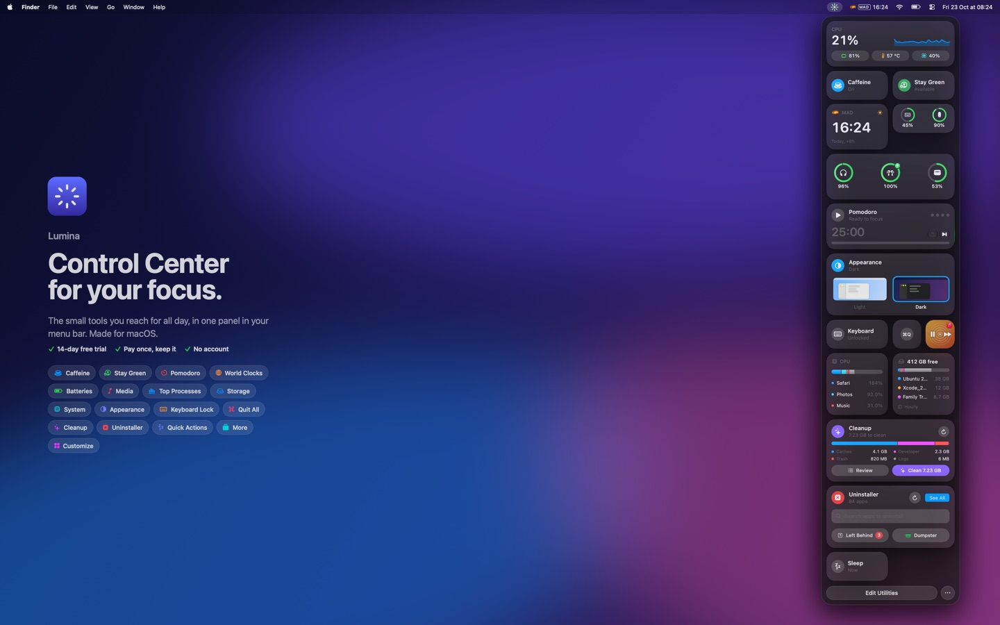
  </picture>

  <a href="https://github.com/hectorgoan/lumina-releases/releases/latest/download/Lumina.zip"><b>⬇︎ Download Lumina 0.1.19</b></a> 
  ✓ 14-day free trial &nbsp; ✓ Pay once, keep it &nbsp; ✓ No account 
  For macOS 26 or later

## What's inside

Click Lumina's icon in the menu bar and everything is there, in tiles you can arrange however you like.

- **Stay focused.** Keep your Mac awake with **Caffeine**, stay "available" in Teams with **Stay Green**, work in rounds with **Pomodoro**, and lock the keyboard to wipe it with **Keyboard Lock**.
- **Know your Mac.** See its vitals with **System**, every battery from your Mac to your AirPods with **Batteries**, what's slowing it down with **Top Processes**, and what's filling your disk with **Storage**.
- **Keep it tidy.** Free up space with **Cleanup**, remove apps and everything they leave behind with **Uninstaller**, close everything at once with **Quit All**, and sleep, mute or empty the Trash with **Quick Actions**.
- **At a glance.** Control what's playing with **Media**, keep the time in other cities with **World Clocks**, and switch between light and dark with **Appearance**.
- **Make it yours.** Add, hide, resize and rearrange tiles, and tuck the ones you use less into a **More** section. Tiles sit on Liquid Glass, and the panel can be glass or frosted.

## Features

<!-- features:start -->
<table>
<tr>
<td width="50%"><a href="marketing/features/caffeine.jpg">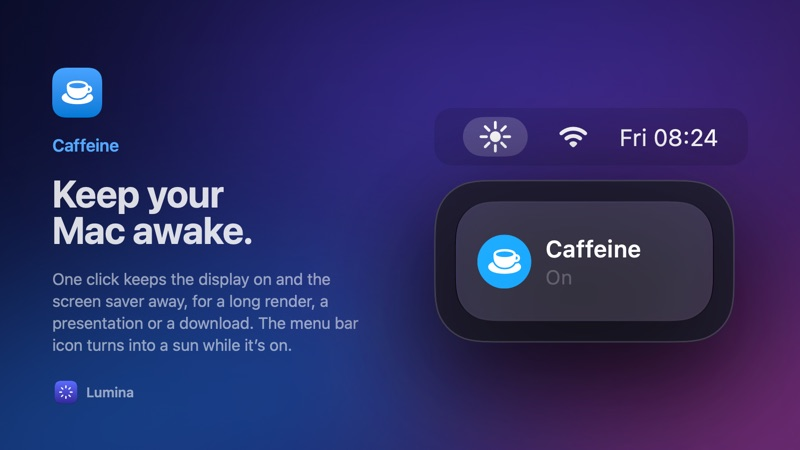</a></td>
<td width="50%"><a href="marketing/features/stay-green.jpg">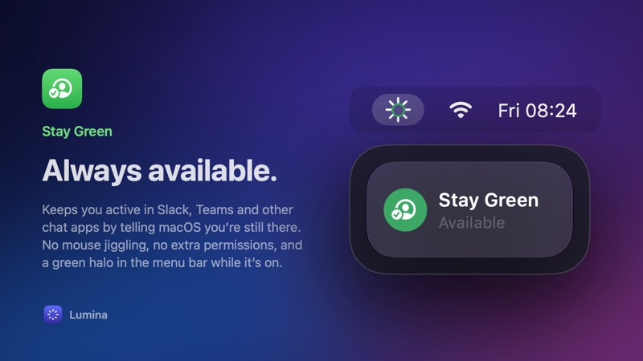</a></td>
</tr>
<tr>
<td width="50%"><a href="marketing/features/pomodoro.jpg">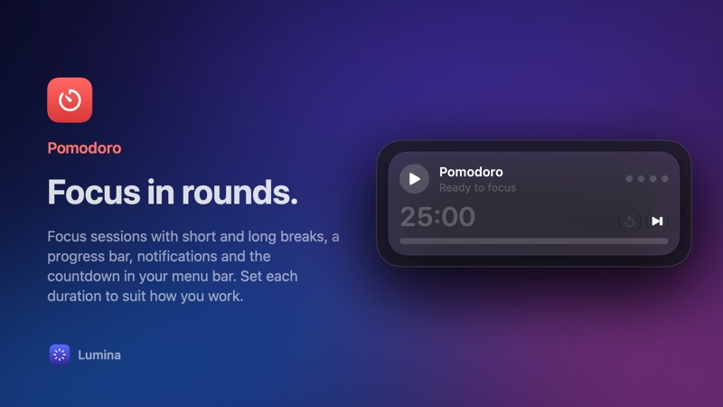</a></td>
<td width="50%"><a href="marketing/features/world-clocks.jpg">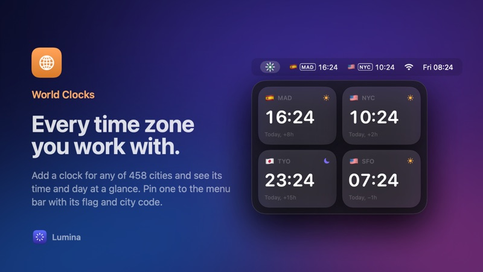</a></td>
</tr>
<tr>
<td width="50%"><a href="marketing/features/batteries.jpg">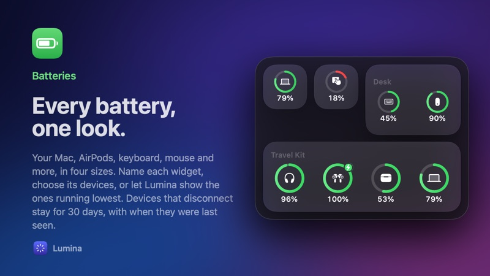</a></td>
<td width="50%"><a href="marketing/features/media.jpg">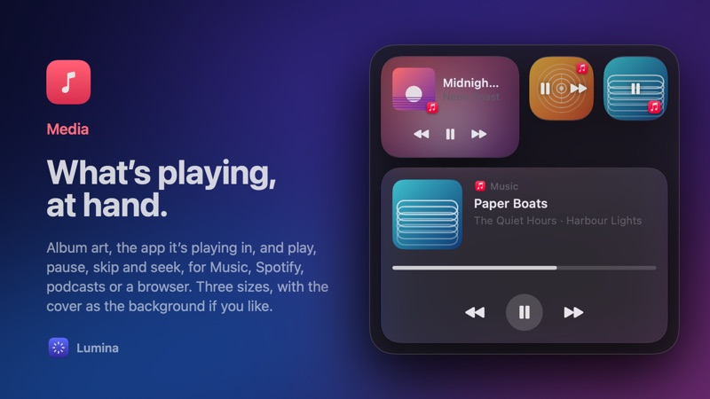</a></td>
</tr>
<tr>
<td width="50%"><a href="marketing/features/top-processes.jpg">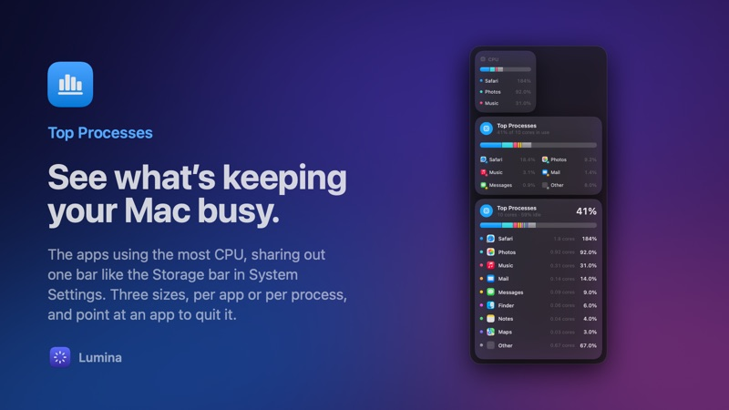</a></td>
<td width="50%"><a href="marketing/features/storage.jpg">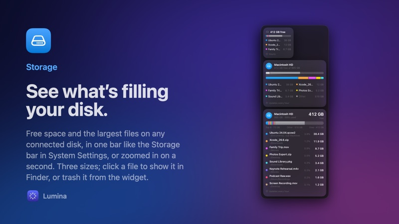</a></td>
</tr>
<tr>
<td width="50%"><a href="marketing/features/system.jpg">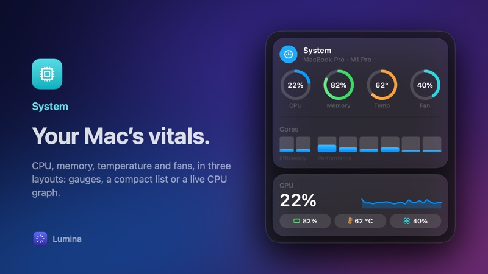</a></td>
<td width="50%"><a href="marketing/features/appearance.jpg">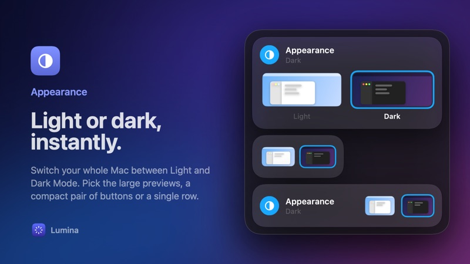</a></td>
</tr>
<tr>
<td width="50%"><a href="marketing/features/keyboard-lock.jpg">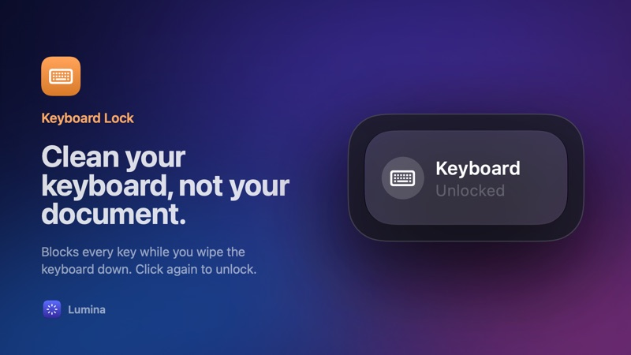</a></td>
<td width="50%"><a href="marketing/features/quit-all.jpg">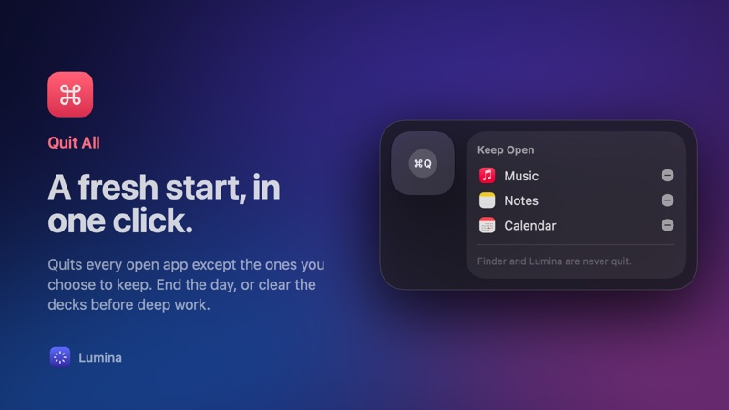</a></td>
</tr>
<tr>
<td width="50%"><a href="marketing/features/cleanup.jpg">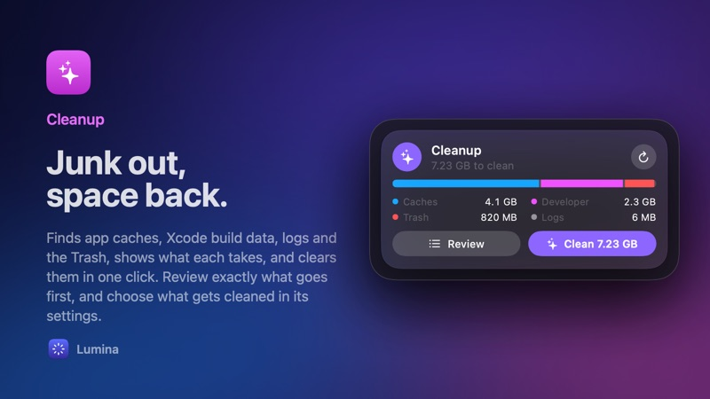</a></td>
<td width="50%"><a href="marketing/features/uninstaller.jpg">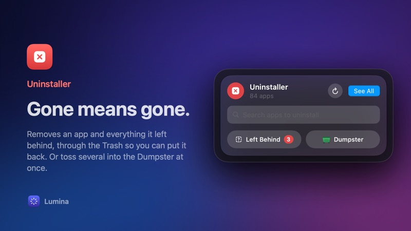</a></td>
</tr>
<tr>
<td width="50%"><a href="marketing/features/quick-actions.jpg">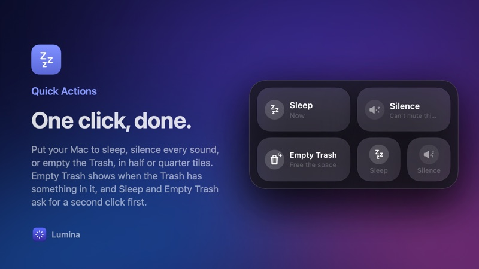</a></td>
<td width="50%"><a href="marketing/features/more-section.jpg">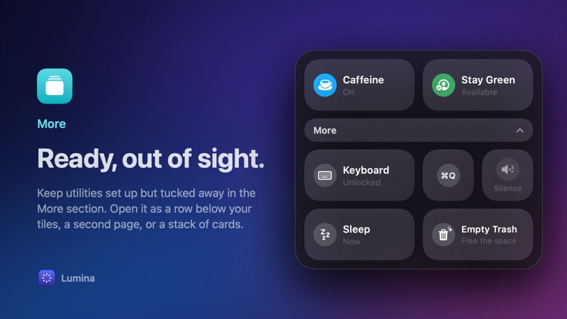</a></td>
</tr>
<tr>
<td width="50%"><a href="marketing/features/customize.jpg">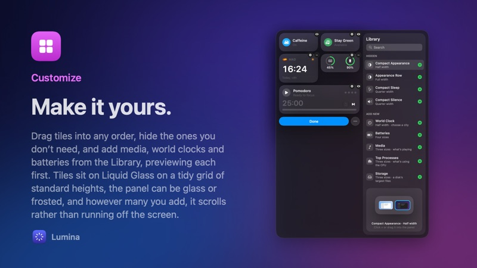</a></td>
</tr>
</table>
<!-- features:end -->

## Install

1. Download **[Lumina.zip](https://github.com/hectorgoan/lumina-releases/releases/latest/download/Lumina.zip)** and open it.
2. Drag **Lumina** into your **Applications** folder, then open it.
3. The first time, macOS says it can't check Lumina for malicious software, because Lumina isn't distributed through the App Store. Open **System Settings › Privacy & Security**, scroll down, and click **Open Anyway** next to the message about Lumina.

You only need to do this once. Lumina's icon appears in the menu bar; click it to open the panel.

Some utilities ask for a permission the first time you use them (for example, Keyboard Lock needs Accessibility). macOS shows the prompt.

## Free trial and licence

- **Try everything for 14 days.** Every utility works during the trial, with no account and no card.
- **Pay once, keep it.** When the trial ends, buy a licence from the panel. You'll get a licence key by email.
- **Enter your key** from the panel: click **…** › **Licence…** and paste it. If you've just copied it, Lumina fills it in for you.
- Your licence works offline and stays with you through every update.

## Updates

Lumina updates itself. It checks when it opens and every six hours, and shows a banner at the top of its panel when a new version is ready. You can also choose **…** › **Check for Updates…**. After an update, the panel shows what's new.

## Privacy

Lumina has no account and collects nothing. Everything it shows is worked out on your Mac. The only thing it fetches is this page's update information.

## Help

Questions or problems? [Email the developer](mailto:hectorgoan@gmail.com?subject=Lumina).
